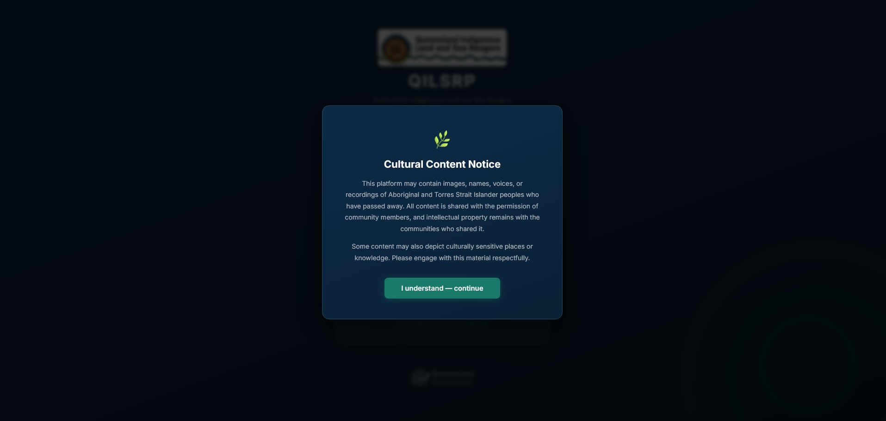
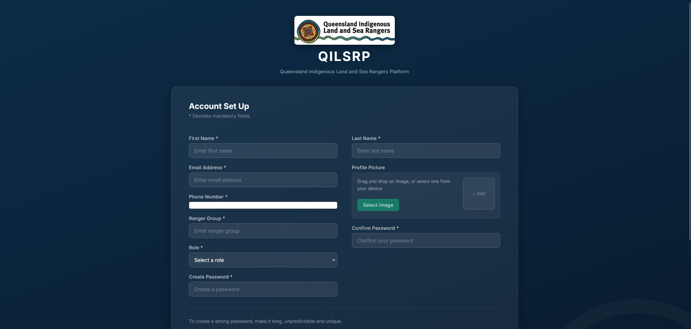
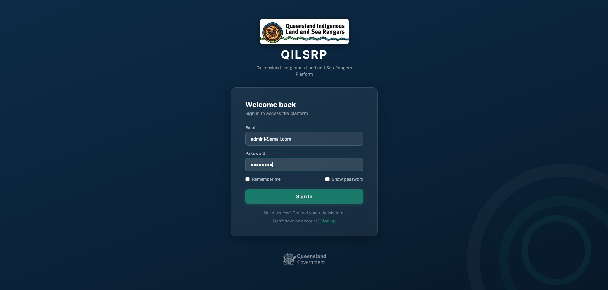
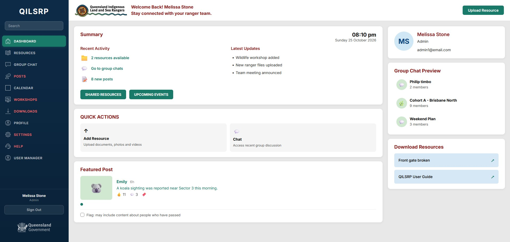
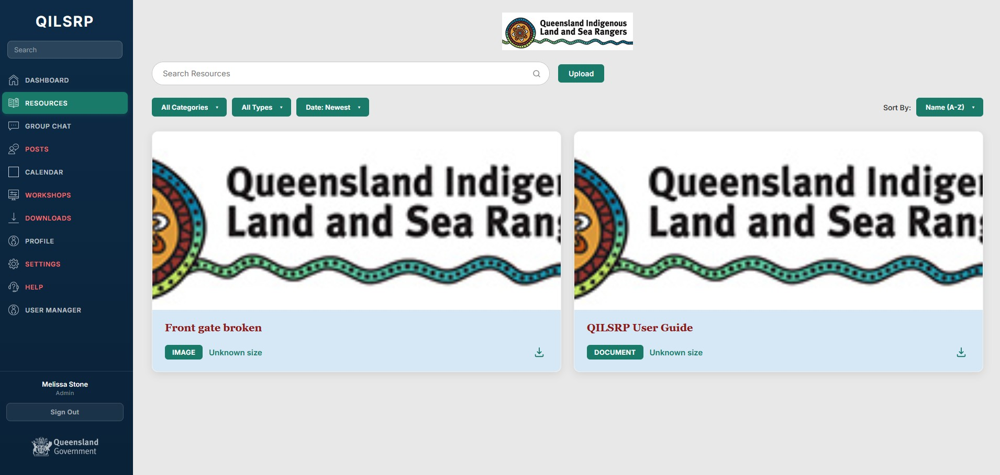
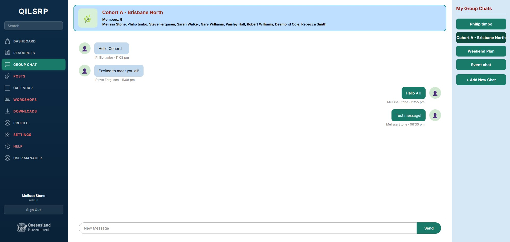
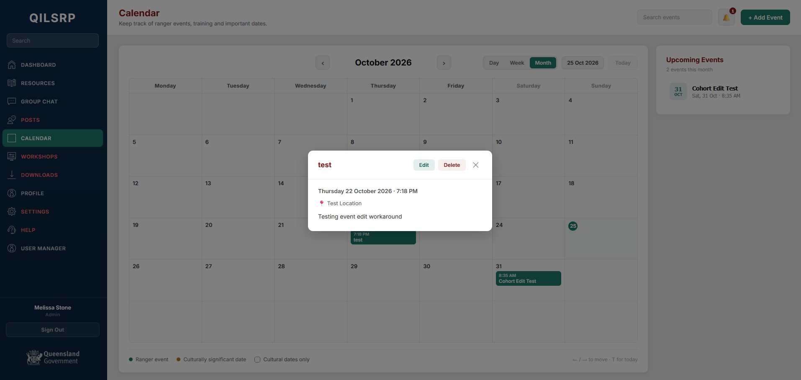
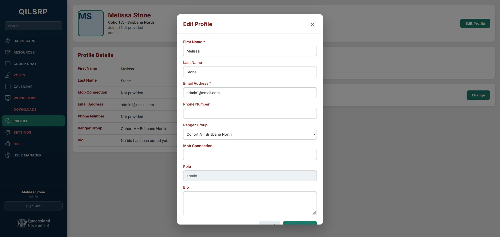
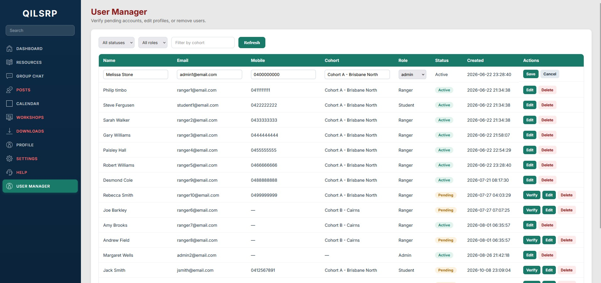

# QILSRP-App Description
This is a communications platform designed to augment the Queensland Indigenous Leadership Program. This program is designed to support Indigenous rangers in enhancing their leadership skills, fostering community networks, and further progressing their personal and professional development. 

The project aims to deliver a web-baseed application that allows for communication between QILSRP rangers, creating a singular platform to replace the currently used selection of third party applications.

Features include resource/multimedia sharing, event scheduling and notifications, group discussions, and administrative tools.

## Important Info
- This repo only contains the back-end and a development front-end. For the official integrated front-end, which was developed by another team, please view [this repository](https://github.com/qilsrpapp-cell/QILSRP-APP-2026).
- Instructions for running this program locally are found below, however due to the app's use of cloud microservices, please note you will need to locally host your own MySQL database (instructions provided), and the 'Resources' functionality is entirely dependent on a cloud service.

## How to Run
1. Install [MySQL Workbench](https://dev.mysql.com/downloads/workbench/) and [node.js](https://nodejs.org/en/download)
### Database Setup
2. Create a new local database instance in MySQL Workbench
3. Either run [this .sql dump file](https://github.com/Michael-Mal/QILSRP-App/blob/main/database/database.sql) or manually create your own database by using the schema outlined [here](https://github.com/Michael-Mal/QILSRP-App/blob/main/database/database_schema.pdf)
4. Insert the connection details for the database into /server/knexfile.js
### App Setup
5. cd into /client and /server and run `npm i` in each to download dependencies
6. Run the server by typing `...\server>npm start` and then run the client by entering `...\client>npm run dev`
7. Enter the link in the console into your web browser, or if you want to look at the server docs, go to http://localhost:3000/

## Screenshots

